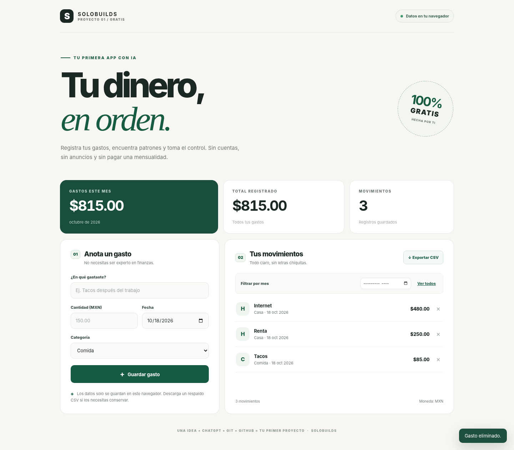

# Mis Gastos — Episodio 01 de SoloBuilds

> **Aprende a crear tu primera app GRATIS con ChatGPT, Git y GitHub.**  
> *De consumidor a creador.*



Proyecto educativo y de código abierto de **[SoloBuilds](https://github.com/Solo-Builds)**. La aplicación registra gastos en pesos mexicanos sin cuentas, anuncios, servidores ni suscripciones. Es una web estática sencilla, hecha con HTML, CSS y JavaScript.

## Qué puedes hacer

- Agregar gastos con **concepto, monto, fecha y categoría**.
- Consultar el **total del mes**, el **total acumulado** y los movimientos.
- Filtrar gastos por mes, eliminarlos y exportarlos a CSV.
- Mantener tus datos en el navegador con `localStorage` (sin enviarlos a un servidor).
- Usar la app en computadora y celular.

## Prueba la aplicación

1. Descarga o clona este repositorio.
2. Abre `index.html` en tu navegador.
3. Añade «Tacos» por $85 MXN y «Camión» por $15 MXN.
4. Comprueba que el total registrado es **$100 MXN**.
5. Actualiza la página y comprueba que los dos movimientos siguen ahí.
6. Prueba el botón **Exportar CSV** y, después, elimina «Camión».

Si tu navegador bloquea `localStorage` en archivos `file://`, usa un servidor local gratuito. Con Python instalado, desde esta carpeta:

```bash
python3 -m http.server 8000
```

Abre <http://localhost:8000/>.

**Demo en GitHub Pages:** se podrá habilitar después de publicar este repositorio. Consulta las instrucciones más abajo.

## ¿Qué hace cada archivo?

| Archivo | Explicación |
| --- | --- |
| `index.html` | Estructura de la página: campos, botones y textos |
| `styles.css` | Colores, espacios, tipografía y diseño adaptable |
| `app.js` | Comportamiento: guardar, calcular, filtrar y exportar |
| `docs/PROMPT-PARA-LA-RAZA.md` | Instrucciones para pedirle a ChatGPT que te ayude a construir tu propia versión |
| `docs/GUION-DEL-VIDEO.md` | Guion y plan para grabar el tutorial en español |
| `docs/PRUEBAS.md` | Pruebas ejecutadas y sus límites |

## ¿Qué son ChatGPT, Git y GitHub?

**ChatGPT:** asistente que puede ayudar a escribir y explicar código. **Git:** guarda un historial de cambios en tu computadora. **GitHub:** plataforma para compartir repositorios y colaborar.

Para experimentar, **haz tu propia copia**:

1. Pulsa **Fork** en la página del repositorio (o descarga el ZIP desde **Code → Download ZIP**).
2. Cambia el título o color de la app y prueba que no se rompa.
3. Si estás usando Git, crea un commit para guardar tu cambio.
4. Comparte el enlace de tu repositorio, **nunca datos financieros ni contraseñas**.

### Aprende Git con tres comandos

En una carpeta de proyecto nueva que todavía no tenga Git:

```bash
git init -b main
git add .
git commit -m "Mi primera app"
```

Antes de hacer el primer commit, configura tu alias y correo de Git si no lo hiciste antes. Para subir un repositorio, necesitas un remoto en GitHub y autenticación segura (por ejemplo GitHub CLI o SSH), no la contraseña de tu cuenta. Para detalles, consulta el guion en `docs/`.

## Cómo habilitar GitHub Pages (publicación gratis)

El administrador del repositorio puede abrir **Settings → Pages**, elegir **Deploy from a branch**, seleccionar `main` y `/(root)` y guardar. Cuando GitHub termine de desplegar, la aplicación podrá abrirse en una dirección parecida a:

`https://solo-builds.github.io/ep01-control-de-gastos/`

Esa URL es **la dirección esperada**, no una afirmación de que la publicación ya esté activa. GitHub Pages es un servicio público: evita subir secretos.

## Privacidad y limitaciones

Los gastos permanecen en el **navegador y origen** donde los registraste, no en GitHub ni en una base de datos. No existe sincronización entre equipos. Si limpias los datos del sitio, cambias de navegador o cambias de `file://` a GitHub Pages, puedes perder el historial original. Exporta CSV para respaldarlo. La app **no permite importar CSV** ni está diseñada para contabilidad profesional; usa datos ficticios en demostraciones.

El uso de ChatGPT no garantiza resultados correctos. **Comprueba el código y pruébalo** antes de instalarlo o publicarlo. Consulta `docs/PRUEBAS.md`.

## Licencia

Código bajo licencia **MIT**; consulta [LICENSE](LICENSE). Puedes copiarlo, modificarlo y compartirlo conservando el aviso de licencia.
